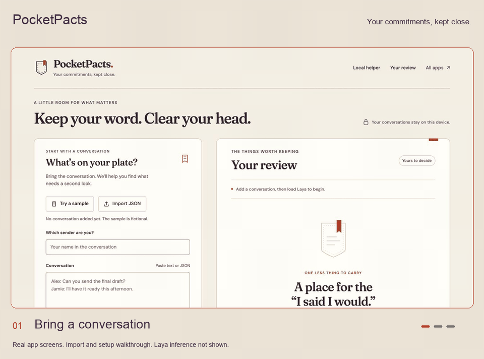

# PocketPacts

**Your commitments, kept close.**

Bring a conversation into a quiet notebook. Find requests, promises, blockers, and messages that may still need your reply, with the original words beside every result. PocketPacts uses the Laya decision model through QVAC SDK 0.22.0 on your computer.



*Import and model setup walkthrough. Live Laya inference was not verified in the initial build because the model download did not complete. Analysis results are not shown.*

## Start locally

Use Node.js 22.21.0 or a compatible version listed in `package.json`. Native model engines need npm optional dependencies and install scripts. The first install and model download require internet access.

```sh
git clone https://github.com/victorchimakanu/pocketpacts.git
cd pocketpacts
npm ci
npm start
```

Open [127.0.0.1:4321](http://127.0.0.1:4321). Click **Try a sample**, enter your sender name, then **Load Laya** and **Review conversation**. The sample is fictional. Analysis requires a successfully loaded model; failures stay visible and never turn into sample scores.

The default `LAYA_MULTILINGUAL_322M_Q8_0` download is 348,425,664 bytes. Allow time and disk space for native dependencies and the model. Later loads verify the default cached model's size and SHA256 checksum, then use its local path. Once dependencies and valid weights are present, inference can run offline.

Already have the Laya GGUF file? Set its absolute path under **Model setup & advanced settings**, or start with:

```sh
QVAC_LAYA_MODEL=/absolute/path/to/laya-multilingual-Q8_0.gguf npm start
```

CPU is the default request. GPU is an optional load preference, not evidence of the backend used or a speed claim. Hardware support depends on the QVAC native engine and your system. Set `PORT` to use a different local port.

## Bring your conversation

Paste `Sender: message` text or import JSON. A message array and an object containing `messages` both work:

```json
{
  "messages": [
    { "id": "1", "sender": "Alex", "text": "I will send the draft.", "timestamp": "2026-10-21T10:00:00Z" },
    { "id": "2", "sender": "Jamie", "text": "Can you include the figures?" }
  ]
}
```

Only `sender` and `text` are required. Supplied IDs must be unique. Your identity must match a sender, and messages must be in chronological order. Plain text starts each turn with a sender and colon. Following lines belong to the preceding turn.

Each import accepts up to 30 messages, 2,000 characters per message, and 60,000 input characters. Optional thread context accepts 600 characters. Invalid input is rejected before inference.

## Read the results

Laya answers four fixed questions for each target message:

1. Does this ask me to do something or provide information?
2. Does this contain a promise made by me?
3. Does this describe a blocker?
4. Does this still need my reply or action after later messages?

The answer is a probability, not a written reply. Each decision includes the full target message and up to six messages on either side, with 240 character excerpts. Missing context, clipped excerpts, or model truncation trigger a review warning. A later resolution outside that window can be missed.

Scores between 35% and 65% are marked uncertain. These are starting review thresholds, not measured accuracy. Confidence has not been calibrated for this task. Read the source before acting. A strong score can still be wrong, and a fulfilled promise can still be recognized as a promise.

Filter the candidates, dismiss reviewed cards, restore them, or export the review as JSON. PocketPacts never sends a reply or connects to a live chat account.

## Your data

The server binds to `127.0.0.1` and accepts its own local origin. Conversation text goes from your browser to that local process for inference. No cloud inference, API key, analytics, or remote fonts are part of this app. Package installation and the default model download contact remote services, so setup is not offline.

The server holds input and scores in memory for the current request and does not save transcripts. Browser local storage keeps only conversation hashes and dismissed message IDs. **Export JSON includes the source text and results**, saved through your browser. Treat that file like the original conversation. The local server is a development app; do not expose it to a network or use it as an authenticated multiuser service.

## Development

```sh
npm test
```

The test suite covers imports, ordering, identity checks, bounded context, malformed probabilities, truncation fields, sequential decisions, API lifecycle, concurrent request refusal, cancellation, load recovery, cache validation, local HTTP protections, and stale UI clearing. SDK responses in API and UI tests are explicitly simulated. They do not test model quality or prove live Laya inference.

CI uses `npm ci --ignore-scripts` because these tests use Node's built-in test runner and simulated SDK calls. A full local `npm ci` with install scripts and optional dependencies is required before loading a model.

| Path | Purpose |
| --- | --- |
| `src/core.mjs` | Import validation, four questions, context windows, score mapping |
| `src/server.mjs` | Model lifecycle and local API |
| `src/public/` | Notebook interface, fictional sample, local fonts |
| `src/test/` | Core, API, and UI state tests |
| `shared/` | Local HTTP server, SDK loading, cache validation, shared tests |
| `design-dna.json` | Interface tokens, style, and visual effects profile |

## Local API

All POST requests use `Content-Type: application/json`.

| Action | Request |
| --- | --- |
| Model state and per-message progress | `GET /api/status` |
| Download and load catalog model | `POST /api/load` with `{}` |
| Load a local file | `POST /api/load` with `{ "modelPath": "/absolute/model.gguf", "device": "cpu" }` |
| Review messages | `POST /api/analyze` with `{ "viewer": "Alex", "conversation": "...", "context": "optional" }` |
| Stop current request | `POST /api/cancel` with `{}` |
| Release model memory | `POST /api/unload` with `{}` |

The implementation uses `loadModel({ modelType: 'llamacpp-decision' })`, then `decide({ modelId, state, questions, maxLen: 2048, headMaxLen: 256 })`, and `unloadModel`. Messages run sequentially. It checks the SDK's `stateTokensDropped` and `truncatedQuestions` fields.

Read the [QVAC SDK 0.22.0 release](https://github.com/tetherto/qvac/releases/tag/sdk-v0.22.0), [tagged decision API](https://github.com/tetherto/qvac/blob/sdk-v0.22.0/packages/sdk/src/client/api/decide.ts), and [Laya guide](https://github.com/tetherto/qvac/blob/sdk-v0.22.0/packages/embed-llamacpp/README.md#laya-decision-models).

## License

MIT for this project. Fraunces and DM Sans are bundled under their own SIL Open Font Licenses in `src/public/fonts/`. Their source records are in [docs/font-sources.json](docs/font-sources.json). QVAC, native dependencies, and model weights keep their respective licenses.

Explore the companion apps: [QuoteMine](https://github.com/victorchimakanu/quotemine) and [ModelGarage](https://github.com/victorchimakanu/modelgarage).
